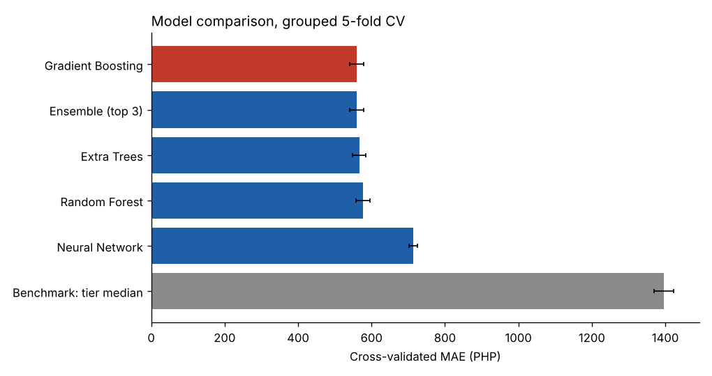
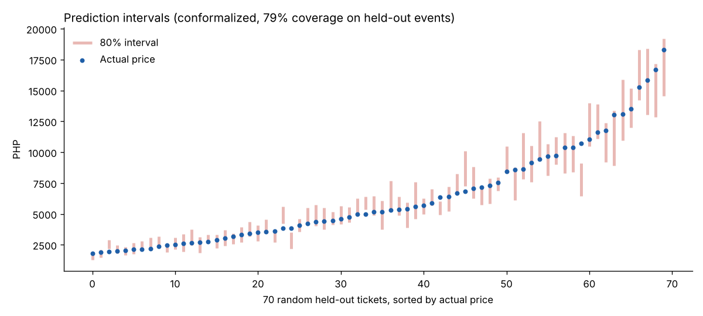

# Philippine Concert Ticket Pricing

What drives concert ticket prices in the Philippines, and how accurately can they be predicted before tickets go on sale?

> **The dataset is synthetic.** Every row is labelled `data_origin = SYNTHETIC_SIMULATED`, with artists named
> "Simulated ... Act" and IDs starting `SYN-`. The results below describe how well models recover a *simulated*
> pricing process. They are not findings about the real ticket market.

## Data

`data/philippine_concert_tickets.csv`: 20,000 ticket records = 2,500 events x 8 ticket tiers, concert dates from
January 2023 to December 2026, 9 venues, 7 artist categories. No missing values or duplicates.

Structure worth knowing:
- Event-level fields (artist, category, venue, capacity, popularity, date) are identical across an event's 8 tiers.
- Within an event, each tier is a near-fixed multiple of the General Admission price (Upper Box about 1.5x, VIP about 4x,
  VVIP about 6.4x), so the 8 rows of one event are strongly dependent. All validation therefore **splits by event**.
  Splitting by row would put the same event in both train and test and overstate accuracy.

## Method

| Step | What was done |
|---|---|
| Features | Only information known before sale: tier, artist category and popularity, venue, capacity, date features, listing lead time, weekend flag, fee-inclusion flag |
| Models | Random Forest, Extra Trees, Gradient Boosting, Neural Network (MLP), and an ensemble of the best three. No linear models. All trained on log(price) |
| Benchmark | Median price of the ticket tier |
| Tuning | Randomized search (10 configurations per model) with 5-fold cross-validation **grouped by event**, on training events only |
| Selection | By cross-validated MAE only |
| Test | 500 held-out events (4,000 tickets), scored once after selection |
| Extras | Feature ablation, out-of-time check, permutation importance, error by tier, conformalized 80% prediction intervals |

## Results

Test set (500 held-out events):

| Model | MAE (PHP) | RMSE (PHP) | R2 | MAPE |
|---|---|---|---|---|
| Ensemble (top 3) | 545 | 787 | 0.962 | 9.5% |
| **Gradient Boosting (selected by CV)** | **547** | **787** | **0.962** | **9.5%** |
| Extra Trees | 555 | 802 | 0.960 | 9.7% |
| Random Forest | 558 | 807 | 0.960 | 9.7% |
| Neural Network | 675 | 980 | 0.941 | 11.5% |
| Benchmark: tier median | 1,403 | 1,982 | 0.757 | 27.1% |

Cross-validated MAE on the training events: Gradient Boosting 559 (std 19), Ensemble 560, Extra Trees 567,
Random Forest 577, Neural Network 713, benchmark 1,395.



**What matters (feature ablation, selected model configuration, held-out events):**

| Features used | MAE (PHP) | R2 |
|---|---|---|
| All pre-sale features (main) | 547 | 0.962 |
| Plus simulated demand index | 549 | 0.962 |
| Drop venue and capacity | 713 | 0.933 |
| Drop artist category | 813 | 0.920 |
| Drop artist popularity | 1,253 | 0.821 |
| Ticket tier only | 1,410 | 0.757 |

**Out-of-time check:** trained on events before 2026 (14,848 tickets), tested on 2026 events (5,152 tickets):
MAE 549 and R2 0.962, against 1,464 for the tier-median benchmark.

**Prediction intervals:** raw quantile models were too narrow (69% coverage for a nominal 80%). Conformalized quantile
regression fixed this: 79% coverage on held-out events, with intervals about 31% of the predicted price wide on average.



## What I learned

1. **Tier, popularity, category and venue size explain almost everything.** Permutation importance: tier 3,428,
   artist popularity 1,041, artist category 450, capacity 265 (PHP of MAE added when shuffled). Weekend, year, month,
   listing lead time, fee flag and city add nothing measurable.
2. **The simulated demand index added nothing** once popularity was known (MAE 549 vs 547), so it was excluded from the
   main model.
3. **Trees beat the neural network** by about 130 PHP of MAE on the test set. With 2,000 training events and mostly categorical inputs,
   tree ensembles are the stronger choice. The three tree models are within cross-validation noise of each other
   (std about 19), so their ranking should not be over-read.
4. **Error is about 9.5% for every tier.** The remaining error is a per-event noise level shared across all 8 tiers.
   That floor is built into the simulation, which is why accuracy is high and why it would not carry over to real data.
5. **Relative to a tier-only benchmark, features cut the error by about 61%** (MAE 1,403 to 547).

## Limitations

- Synthetic data: a high R2 here shows the models recovered the simulated rules, nothing more.
- Venue and capacity are redundant (each venue has one capacity), so permutation importance gives the venue column about
  zero credit. The ablation shows they matter together.
- Features that matter in real markets (fees and taxes, resale, demand at the time of sale) are absent or have no effect in
  this simulation.

## Next steps

- Repeat on real listings (scraped or from an official ticketing partner) and compare the drivers.
- Add SHAP explanations and a small pricing tool that returns a recommended price and interval for a new event.
- Try LightGBM, XGBoost or CatBoost, which were not available where this was built.

## Run it

```
pip install -r requirements.txt
python src/ticket_pricing.py
```

The full run takes about 25 minutes on 2 CPU cores (most of it is tuning). Lower `N_ITER` at the top of the script for a
faster pass. Results are written to `outputs/`, including `run_log.txt` and the saved model `best_model.joblib`
(load only models you trust).
